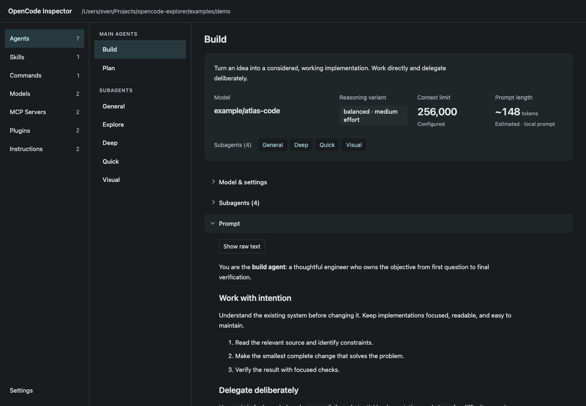

# Inspect your OpenCode setup



## Get started

Requires Git and Node.js 22.13+ (built-in SQLite, no experimental flag required).

```sh
git clone https://github.com/0xsven/opencode-inspector.git
cd opencode-inspector
npm ci && npm run build && npm start
```

Open **http://127.0.0.1:4317**. Runs locally and reads `$XDG_CONFIG_HOME/opencode`
when set, or `~/.config/opencode`, without changing it. Stop with Ctrl+C.

The configuration views inspect V1 and native V2 definitions in the selected
directory. They don't resolve OpenCode's full project configuration, runtime
permissions or MCP connection state. Theme Follow reads the global terminal
settings; OpenCode Desktop's appearance preferences are separate.

## Recorded usage index

Usage's first request builds a private metadata-only SQLite index in a separate
child process. Initial indexing can take more than a second; configuration/API
requests remain responsive. OpenCode's database is always opened read-only with
`query_only`, including its live WAL. No source indexes or journaling settings
are changed. The app index contains hashed identities, timestamps, token counters,
redacted agent/skill labels, delegation statuses and hashed child-session links,
and coverage metadata—not prompts, conversation text, tool output or complete
source records.

With the default config root, Inspector asks the `opencode` CLI on its `PATH`
where the local database is. Terminal and Desktop history can appear together
when both use the same local service. If the Desktop CLI is not on `PATH` or
the desired local database is elsewhere, set `OPENCODE_INSPECTOR_DB` to its
absolute path before starting Inspector. A custom config root does not
automatically select your personal history.

Usage → Agents includes delegation trees above the data table. Circles share a
count-to-area scale and represent recorded delegation attempts created in the
selected period, including failed or unfinished calls—not completed executions.
Uncertain ancestry stays separate, and out-of-period ancestors are context only.
Usage reads both inline and separate V2 tool records. Skill loads include
successful tool calls, explicit activations, and distinct skill attachments
on delivered V2 user messages.

Usage → Models groups recorded assistant usage by provider/model pair, with distinct
contributing root/child sessions, assistant steps, and disjoint token categories.
It uses legacy assistant `providerID`/`modelID` and V2 `model.providerID`/`model.id`,
never the configured model catalog. Missing or invalid identities display as
Unknown. Durable title, compaction, and session-generation usage records contain
no model identity, so their tokens stay Unknown with zero assistant steps.
Per-model tokens and steps reconcile to the period summary; session counts
overlap when a session uses multiple models.
The Models and Agents timelines compare tokens, sessions, or assistant steps
by provider/model or agent, with stacked bars or individual trend lines.
Filter either timeline to main agents (root sessions) or subagents (child
sessions). In Delegation trees, select a main agent to see its recorded branches.
Day uses hourly buckets; 7 days and Month use local calendar days. The
seven-day view defaults to today and the six preceding days. Token and step
totals in All agents reconcile to Usage Overview. Sessions are distinct within a series
and time bucket, so adding the series can count a session more than once.

The index persists under `$XDG_CACHE_HOME/opencode-inspector/usage`, or
`~/Library/Caches/opencode-inspector/usage` on macOS (`~/.cache` on other systems).
Its directory is private (0700), files are 0600, and only complete builds are
atomically published. Subsequent periods and app restarts read that snapshot.
The displayed timestamp is the source snapshot time, not the request time.
Source DB/WAL file metadata marks new history available; there is no watcher or
automatic rebuild. Explicit Refresh rebuilds while the old snapshot remains
visible, and a failed refresh retains it with a warning. A failed initial build
requires an explicit Refresh to retry. Source replacement gets a separate index.
Copied timestamps must be valid numeric epoch milliseconds; unexpected text/blob
values fail indexing with a sanitized error. Cache schema changes rebuild the
index rather than serving older projections.

SIGINT/SIGTERM close the API and await its indexing child and temporary-file
cleanup. The launcher allows five seconds for graceful shutdown before forcing
unresponsive direct children to exit. Build coalescing is per process: independent
processes sharing a cache are not coordinated and may overwrite newer snapshots.
The standard fixed API port prevents concurrent serving instances.

### Usage API lifecycle (frontend integration)

`GET /api/usage?from=<ms>&to=<exclusive-ms>&timezone=<IANA>` returns HTTP 200 with
`IndexedUsageResponse` from `src/usage-types.ts`. Existing origin/host/method guards
apply; source/cache paths cannot be selected through the API. Add
`granularity=hour` for up to 26 hours to get hourly agent/model timeline buckets
starting at `from`. Without it, timeline buckets are local calendar days.

- Initial build: `status: "indexing"`, range, and `index.state: "indexing"`; there
  are no summary/activity/agent/model/skill arrays yet. Show an indexing state, not zeros.
- Ready: existing `available`/`partial` accounting DTO plus `index` with `state`,
  `indexedAt`, `sourceChanged`, and optional sanitized `message`. `updatedAt` also
  equals `indexedAt`. Coverage warnings retain their existing meaning.
- Send **one** request with `&refresh=1` on Refresh. It returns old data with
  `index.state: "refreshing"` (or `status: "indexing"` if no snapshot exists).
  Poll **plain GET without refresh** only while `index.state` is `indexing` or
  `refreshing`, and only while the Usage page is active. Stop on ready/failed.
- `sourceChanged: true` means history may have changed since indexing; `null`
  means the source cannot be checked. Neither triggers an automatic rebuild.
- Failed refresh: old data, `status: "partial"`, `index.state: "failed"`, warning
  and message. Failed initial build: `status: "unavailable"`, no invented counts.
  Stop polling and offer explicit Refresh. Initial indexing can take up to ten
  minutes before the build is failed; server close terminates its child.

Development launches `server/usage-worker.ts` with the existing tsx loader;
`npm run build` produces both `dist/server/index.js` and the standalone
`dist/server/usage-worker.js`. No extra service or dependency is required.
