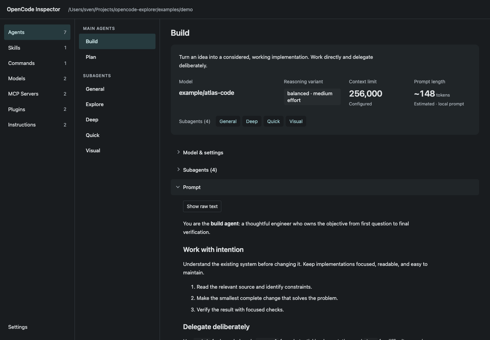

# Inspect your OpenCode setup



## Get started

Requires Git and Node.js 22+.

```sh
git clone https://github.com/0xsven/opencode-inspector.git
cd opencode-inspector
npm ci && npm run build && npm start
```

Open **http://127.0.0.1:4317**. Runs locally and reads `~/.config/opencode` without changing it. Stop with Ctrl+C.
